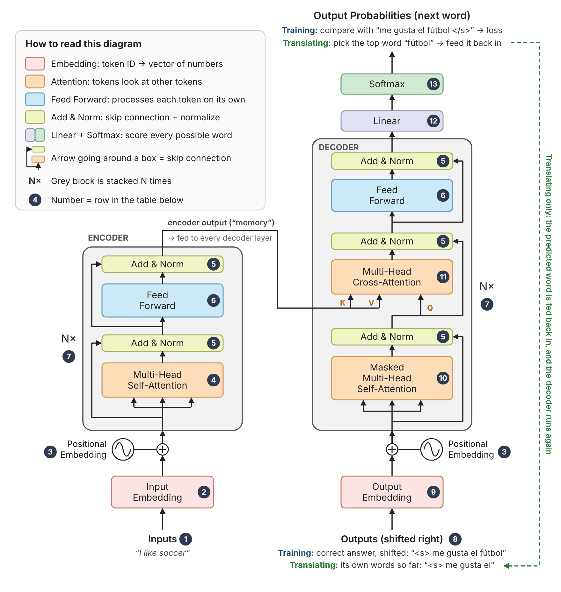

# Assignment 07 — Hussein Jawad
**E89 Deep Learning · NLP with Transformers** (based on Géron, *Hands-On ML*, Ch. 15)

---

# Part 0 — What is a Transformer? A visual primer

## The idea in 30 seconds

A **Transformer** is a neural network that turns one sequence of **tokens** (words or pieces of words) into another. Translation is the classic example. It was introduced in the 2017 paper *"Attention Is All You Need"*.

### From words to numbers: tokenizer & vocabulary

- **Vocabulary:** a fixed, numbered list of tokens, **built once from the training text** by keeping the most common words or word pieces. Pretrained models come with their own.
- **Token ID:** a token's number **in the vocabulary**, *not* its position in the sentence. `like` is always `5`, wherever it appears.
- **Tokenizer:** splits text and looks up each token: `"I like soccer"` → `[I, like, soccer]` → `[4, 5, 6]`. Special tokens get IDs too: `<pad>`=0, `<s>`=1, `</s>`=2.
- **Position** is added later by the **Positional Embedding** [3], and the vocabulary size **V** sets the size of the embedding table [2] and the output layer [12] *(numbers refer to the diagram below)*.

**Why "Transformer"?** Apart from the embedding and output layers, **every layer takes a tensor of shape `[batch size, sentence length, embedding size]` and returns a tensor of exactly the same shape**.

*Example:* a batch of 3 sentences. Shorter ones are padded with `<pad>` to match the longest, and every cell holds one token's vector of 512 numbers:

| | Token 1 | Token 2 | Token 3 | Token 4 |
|---|---|---|---|---|
| **Sentence 1** | I | like | soccer | `<pad>` |
| **Sentence 2** | Hello | `<pad>` | `<pad>` | `<pad>` |
| **Sentence 3** | She | plays | the | piano |

**What the three numbers mean:**

| Dimension | Meaning | In the example |
|---|---|---|
| **Batch size** | Sentences processed together (faster on a GPU) | **3** (rows) |
| **Sentence length** | Tokens in the longest sentence in the batch | **4** (columns) |
| **Embedding size** | Numbers describing each token (512 in the paper, 128 in Géron's small model) | **512** (inside each cell) |

So the shape is **`[3, 4, 512]`**. The tensor stays the same size. What changes is what each token's vector *means*: it is **gradually transformed**, layer by layer, until it captures what the token means *in this particular sentence*.

> **Example (Géron):** the word **"like"** is vague on its own ("I'm *like* a cat" vs. "I *like* my cat"). After the encoder has seen the whole sentence "I like soccer", the vector for "like" captures the meaning *"to be fond of"* and the fact that it is a verb.

The model has two halves. Think of a **human interpreter** translating "I like soccer" into Spanish:

| | **Encoder** (left of the diagram) | **Decoder** (right of the diagram) |
|---|---|---|
| **Job** | Reads the whole source sentence. Outputs **one context-rich vector per token**. | Takes the encoder's notes + **the translation so far**. Predicts the **next token**. |
| **Interpreter** | First **reads the whole English sentence** and puts a note on every word saying what it means *here*: "like" → *"verb: to be fond of"*. | Then **speaks Spanish one word at a time**. Before each word: ① recalls what they've already said ("me gusta el…") ② checks the note for "soccer" → says **"fútbol"**. |

① is **masked self-attention** [10]: the decoder can only look back at words already said. ② is **cross-attention** [11]: the decoder looks at the encoder's notes.

## The running example (from Géron)

We translate **"I like soccer" → "me gusta el fútbol"**. The encoder reads the English sentence **once**. The decoder then runs in a **loop**: each run sees the translation so far, predicts **one** next word, and adds it, like phone autocomplete. It stops when it predicts the end token `</s>`:

| Call | Decoder input (translation so far) | Predicted next token |
|---|---|---|
| 1 | `<s>` | `me` |
| 2 | `<s> me` | `gusta` |
| 3 | `<s> me gusta` | `el` |
| 4 | `<s> me gusta el` | `fútbol`  ← *shown in the diagram below* |
| 5 | `<s> me gusta el fútbol` | `</s>` → **stop** |

`<s>` = start-of-sequence token, `</s>` = end-of-sequence token.

---

## The architecture at a glance

Read the diagram **bottom → top**. The numbered circles match the table below. The colours follow the original paper's figure. The example shows call 4 from the table above: the decoder has `<s> me gusta el` and predicts **fútbol**.

- **N** = number of stacked layers: **6 in the paper**, **2 in Géron's small model**.
- **Softmax [13]:** in PyTorch this is *not* a layer inside the model. The model outputs **logits**, and `nn.CrossEntropyLoss` applies the softmax internally. Call `F.softmax()` if you want the probabilities.

---

## Each element, step by step

**Shapes:** `B` = batch size, `L_src` / `L_tgt` = longest source / target sentence in the batch, `d` = embedding size (`d_model`: **512** in the paper, **128** in Géron's small model), `V` = vocabulary size.

| # | Element | What it does (plain English) | Output shape |
|---|---|---|---|
| **1** | **Inputs** | The source sentence as **token IDs** (integers). Shorter sentences are padded with `<pad>` so every sentence in the batch has the same length. | `[B, L_src]` |
| **2** | **Input Embedding** | `nn.Embedding` looks up a **vector of `d` numbers** for each token ID. At this point "like" still has its vague, out-of-context meaning. | `[B, L_src, d]` |
| **3** | **Positional Embedding** `(+)` | Attention is **position-agnostic**: without help, "dog bites man" and "man bites dog" look the same. So **position vector #i is added to token #i**. The paper used fixed sine/cosine waves. Géron uses **learned** position vectors (`nn.Parameter`) plus dropout, which works just as well. | same |
| **4** | **Multi-Head Self-Attention** (encoder) | Each token **looks at every token in the same sentence**, including itself, and pulls in what is relevant. This is where "like" notices the subject "I" and works out that it is a verb. "Multi-head" means this happens in **several heads in parallel** (8 in the paper, 4 in Géron), and each head can focus on a different feature (tense, meaning, …). | same |
| **5** | **Add & Norm** | **Add:** a skip connection adds the sub-layer's input back to its output. **Norm:** `LayerNorm` keeps the values in a stable range. Together they make deep stacks trainable. This wraps **every** sub-layer. In code: `norm1(src + dropout(attn))`. | same |
| **6** | **Feed Forward** | Two `Linear` layers with a ReLU in between: `d → 2048 → d`. It works on **each token separately**. Attention *mixes* information *between* tokens; the feed-forward block *processes* it *within* each token. | same |
| **7** | **N× stacking** | The layer (4 → 5 → 6 → 5) is repeated **N times**, and each layer refines the vectors further. The encoder's final output (PyTorch calls it the **memory**) is sent to **every** decoder layer. | `[B, L_src, d]` |
| **8** | **Outputs (shifted right)** | During training the target is `me gusta el fútbol </s>`, and the decoder is fed the same sentence **shifted right by one**: `<s> me gusta el fútbol`. Position *t* then has to predict token *t + 1*. This is called **teacher forcing**. | `[B, L_tgt]` |
| **9** | **Output Embedding + Positional** | Same as **2** and **3**, but for the target tokens. In Géron's code these are literally the **same layers**, because both languages share one vocabulary. | `[B, L_tgt, d]` |
| **10** | **Masked (causal) Self-Attention** (decoder) | Like **4**, but each token may only look at **itself and earlier tokens**. For example, "gusta" sees `<s>`, "me" and "gusta", but **not** "el" or "fútbol". Without the mask the model could copy the answer during training. | same |
| **11** | **Cross-Attention** (encoder → decoder) | The two halves **connect** here. **Queries (Q)** come from the decoder, and **keys (K) and values (V)** are the **encoder's final outputs**. When the decoder turns "el" into "fútbol", it pays close attention to **"soccer"**. | same |
| **12** | **Linear** | Maps each vector to **one score (logit) per vocabulary token**. Ideally the correct next token gets a high logit and every other token a low one. | `[B, L_tgt, V]` |
| **13** | **Softmax** | Turns the logits into **probabilities that sum to 1**, e.g. `P("fútbol") = 0.92`. In PyTorch it lives inside `nn.CrossEntropyLoss`. | `[B, L_tgt, V]` |

---

## How this connects to HW07

| Problem | Transformer concept involved |
|---|---|
| **1 – spaCy:** `prince − man + woman` | **Embeddings** (box **[2]**): meaning stored as vectors, so vector arithmetic and **cosine similarity** capture relationships between words. |
| **2 – French → English** | Géron's `NmtTransformer` with the languages swapped: **French** goes into **[1]** and **English** comes out of **[13]**. Hold out 10% of the pairs as the test set. |
| **3 – GPU memory** | Memory holds the **model weights**, the **Adam optimizer state** (two extra values per weight), **activations**, and the **attention grids**, which grow with *L²*. Géron's cleanup recipe: `del` the objects, then `gc.collect()`, then `torch.cuda.empty_cache()`. |
| **4 – BLEU score** | Scores a translation by how many **n-grams** (1–4 word chunks) it shares with a human reference translation. Higher is better. |

> **Coming up:** the next two cells walk through the whole translation and one training step. After that, *Going deeper* (optional) covers how attention computes its weights, the masks, and where each diagram box lives in Géron's code. Come back to that one when you start Problem 2.
